<a href="https://hicham-alaoui0.github.io/"></a>


<a href="https://github.com/hicham-alaoui0/methodology-rag"></a>
<a href="https://github.com/hicham-alaoui0/llm-evalkit"></a>
<a href="https://hicham-alaoui0.github.io/projects/aloi/"></a>
<a href="https://hicham-alaoui0.github.io/projects/agentdeck/"></a>

<a href="https://github.com/hicham-alaoui0/llm-evalkit"></a>


<a href="https://hicham-alaoui0.github.io/"></a>

<a href="https://hicham-alaoui0.github.io/CV_Hicham_Alaoui.pdf"></a>
<a href="https://hicham-alaoui0.github.io/CV_Hicham_Alaoui_FR.pdf"></a>

